<a href="https://jonashaude.de">
<picture>
  <source media="(prefers-color-scheme: dark)" srcset="assets/hero-dark.svg">
  
</picture>
</a>

<a href="mailto:hallo@jonashaude.de"><picture><source media="(prefers-color-scheme: dark)" srcset="assets/btn-mail-dark.svg"></picture></a>&nbsp;
<a href="https://jonashaude.de"><picture><source media="(prefers-color-scheme: dark)" srcset="assets/btn-web-dark.svg"></picture></a>&nbsp;
<a href="https://linkedin.com/in/jonashaude"><picture><source media="(prefers-color-scheme: dark)" srcset="assets/btn-linkedin-dark.svg"></picture></a>&nbsp;
<a href="https://instagram.com/jonashaude"><picture><source media="(prefers-color-scheme: dark)" srcset="assets/btn-instagram-dark.svg"></picture></a>

<picture>
  <source media="(prefers-color-scheme: dark)" srcset="assets/fixes-dark.svg">
  
</picture>

<a href="https://scala-x.de">
<picture>
  <source media="(prefers-color-scheme: dark)" srcset="assets/scalax-dark.svg">
  
</picture>
</a>

<a href="mailto:hallo@jonashaude.de">
<picture>
  <source media="(prefers-color-scheme: dark)" srcset="assets/kontakt-dark.svg">
  
</picture>
</a>

